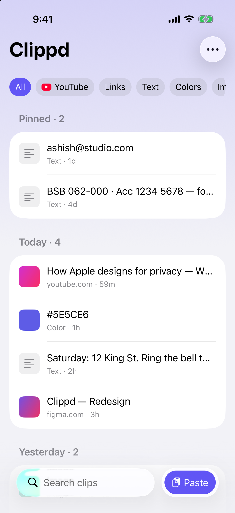
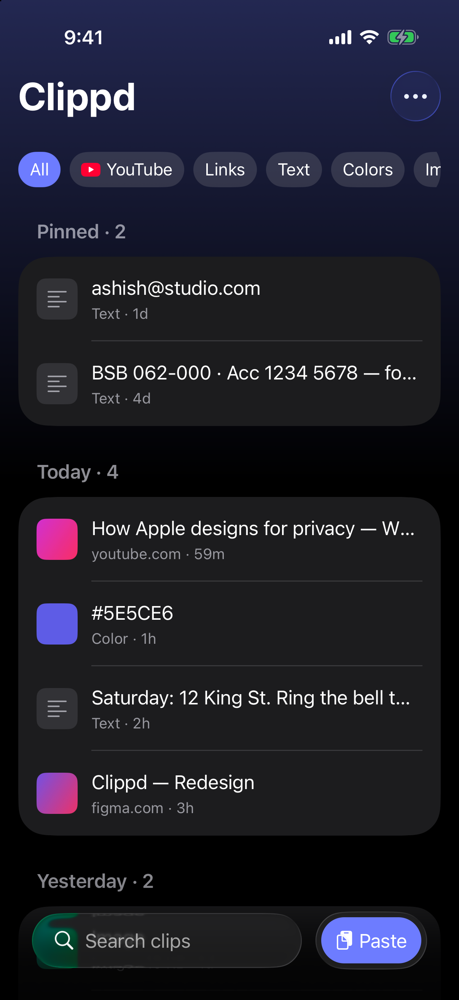
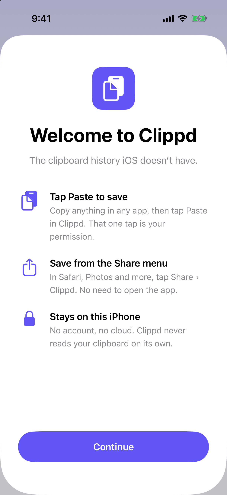
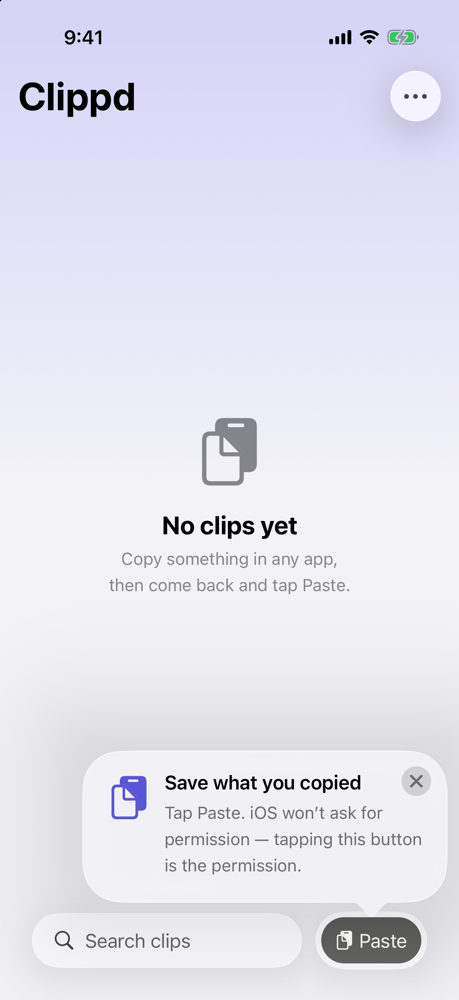
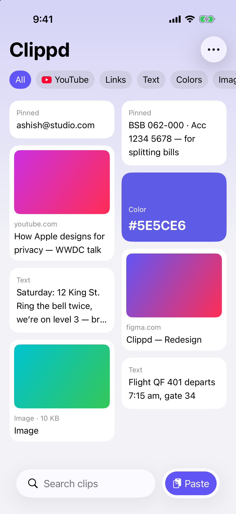

# Clippd

The clipboard history iOS doesn't have.

Clippd is a privacy-first clipboard manager for iPhone. I'm a product designer, not an iOS engineer, and I designed and built it with AI as a learning project and a real app I wanted to use myself.

<p align="center">
  
  &nbsp;&nbsp;
  
</p>

## Why it exists

I copied an address, then a link, and the address was gone. My iPhone only remembers the last thing you copied. My Mac has clipboard managers for this, so I wondered why there was nothing like it on iOS.

The answer is privacy. iOS doesn't let apps read the clipboard in the background, and when an app reads it in code while open, iOS shows an "Allow Paste" prompt. My first version read the clipboard every time it opened, so it asked on every single open.

So Clippd stopped asking. It uses Apple's system **Paste button**: iOS hands over what you copied only when you tap it, and no prompt appears, because the tap itself is the permission.

## How you save a clip

There are two ways in, and both are started by you.

1. **Paste:** copy anything, open Clippd, tap **Paste**.
2. **Share:** in Safari, Photos or any other app, tap **Share › Clippd**. It saves without opening the app.

<p align="center">
  
  &nbsp;&nbsp;
  
</p>

New users see a one-time welcome sheet, then a single tip on the Paste button. There's no multi-step tour.

## Features

- Saves **text, links, colours and images**
- **Clips show themselves:** images become thumbnails, hex colours become swatches, links show a preview
- **Pinned** clips stay at the top and are never removed by the history limit
- Clips are **grouped by day** ("Today · 4") with a clip count
- **Smart filters** (YouTube, Links, Text, Colours, Images) that only appear when you have that kind of clip
- **Search** in the bottom bar
- **List or Board** layout, from the ⋯ menu
- Tap to copy, swipe to pin or delete, long-press for more
- **Select mode** to copy, pin, share or delete several clips at once
- **Settings:** history limit (20 to 200 clips), link previews on or off, storage used, clear all
- Light and dark mode, Dynamic Type and VoiceOver, all from native components

<p align="center">
  
</p>

## Privacy

- Everything is stored **on your iPhone**. No account, no server, no analytics, no tracking.
- Clippd **never reads your clipboard on its own**. It only sees what you hand it with Paste or Share.
- **Link previews** are the only network activity. To show a link's title and image, the app asks that website directly. Nothing goes to me or any third party. Previews can be turned off in Settings; links then show a simple icon instead.

Full policy: [PRIVACY.md](PRIVACY.md)

## Built with

| Part | What it does |
|---|---|
| `SwiftUI` | The whole interface, using Apple's native components only |
| `PasteButton` | The system Paste button that reads the clipboard without a prompt |
| `SwiftData` | On-device storage for clips |
| Share extension (`ClippdShare`) | Saves from other apps' Share menu |
| App Group (`group.com.ashish.clippd`) | A shared folder so the app and the extension use the same database |
| `LinkPresentation` | Optional link previews |
| `TipKit` | The one-time tip on the Paste button |

No third-party dependencies. Requires **iOS 18** or later.

## Project structure

```
clippd/            the iPhone app
  Views/           Home, row and card, Settings, Welcome
  Models/          ClipboardItem (SwiftData), display helpers, settings, sample data
  Services/        ClipboardReader (handles Paste), LinkPreviewFetcher
ClippdShare/       the Share extension
docs/screenshots/  screenshots used in this README
```

Design and planning docs live alongside the code:

- `PRODUCT.md`: who it's for and the design principles
- `DESIGN.md`: the visual system
- `CASE-STUDY-LOG.md`: every design decision and why it was made
- `clippd/Instructions/REQUIREMENTS.md`: the original plan

The Figma file has every exploration, the final screens in light and dark, and a short case study.

## Running it

Open `clippd.xcodeproj` in Xcode and run the **Clippd** scheme on an iPhone simulator or device. You'll need your own team and App Group ID to run it on a device.

For screenshots and testing, debug builds accept launch arguments:

```
-seedSampleData             fills the app with example clips
-hasSeenOnboarding YES      skips the welcome sheet
-layout board               opens in Board layout
```

## What I learned

- **Read the platform's rules first.** It would have saved me a whole version.
- **AI made exploring cheap. Choosing was still my job.** Each round was built from Apple's iOS 26 kit, and I pushed back, picked a direction and threw the rest away.
- **Building it caught what no mockup could.** The Share extension runs as a separate program and couldn't see the app's settings, so it read the history limit as 0 and could have deleted every clip. Fixed before release.

## Status

Version 1.0, preparing for the App Store.

---

Made by [Ashish Jangra](https://x.com/feat_ashish), a designer who wanted a better clipboard and learned by building one.
